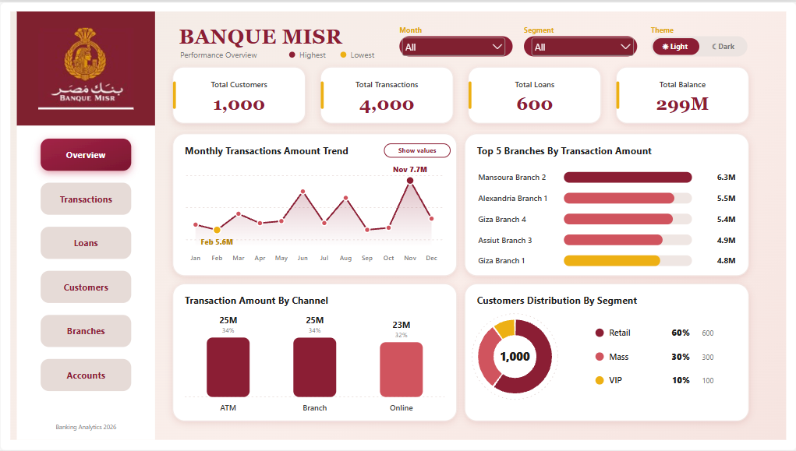
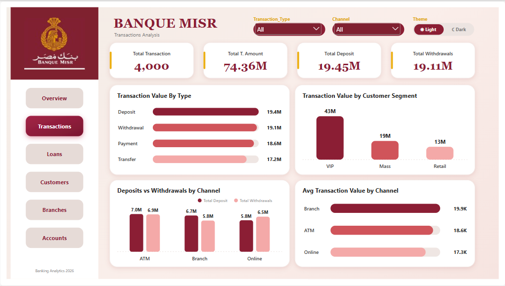
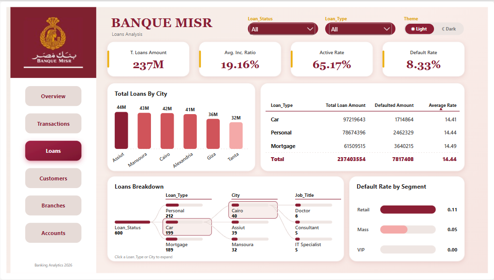
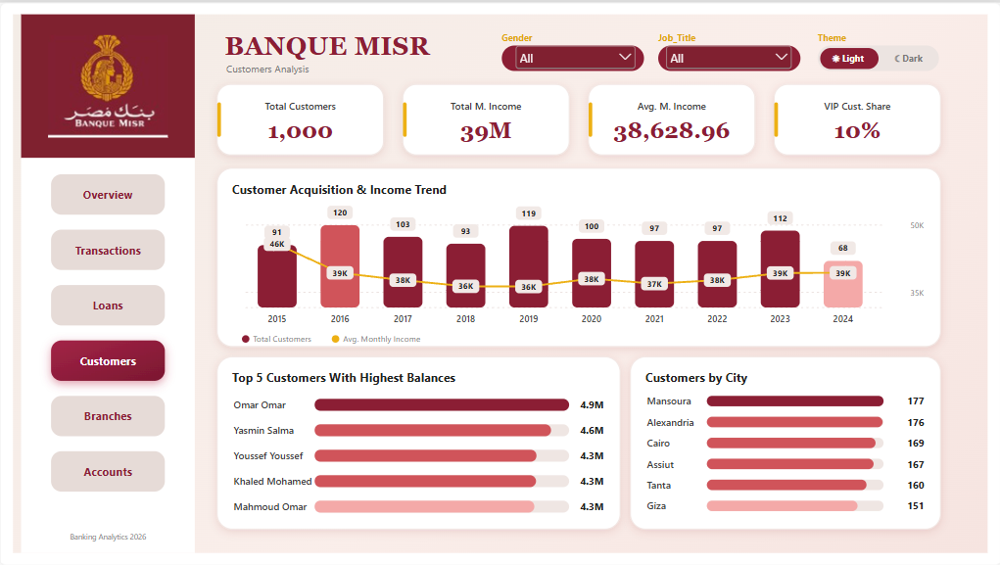
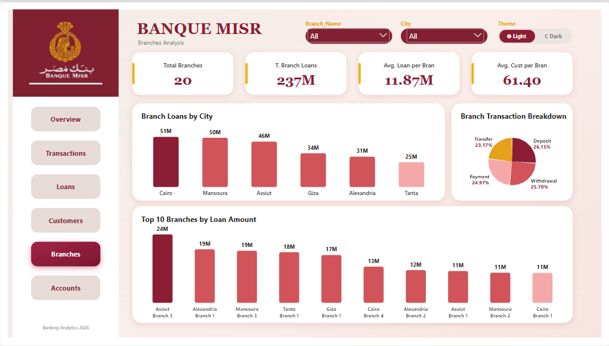
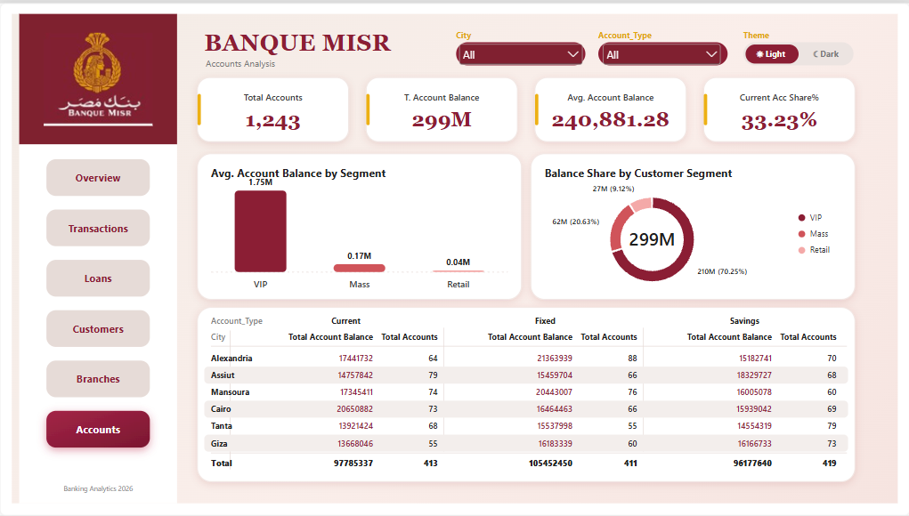

# Banque Misr Banking Analytics | Power BI Dashboard

An interactive Power BI dashboard that turns raw banking data into a clear, decision-ready story across six report pages: Overview, Transactions, Loans, Customers, Branches and Accounts.

## Preview

## Project Goal
Give management one place to understand how the bank performs: how money moves, how the loan portfolio looks, who the customers are, how branches compare, and how accounts are distributed.

## Report Pages
| Page | What it answers |
|---|---|
| Overview | How is the bank doing at a glance? |
| Transactions | How does money move over time and by type? |
| Loans | What does the loan portfolio look like and how does it perform? |
| Customers | Who are the customers and how do they behave? |
| Branches | How do branches compare with each other? |
| Accounts | What are the balances and account types? |

## Data Model
Star-style model: dimension tables (such as Customers Dim and Branches Dim) filter the fact tables. Relationships are single direction, many-to-one.

## Key DAX Measures
- Total Loan Amount
- Total Branch Loans (loans per branch through the customer's primary branch)

## Tools
Power BI Desktop, Power Query, DAX, custom HTML visuals

## Files
- `Banque Misr Project.pbix`: the Power BI report
- `images/`: page screenshots

## Dataset
Dataset provided by the course instructor for a learning project.

## Team
- [Norhan Sultan](https://www.linkedin.com/in/norhan-sultan-6489a5414)
- [Donia Magdy]
